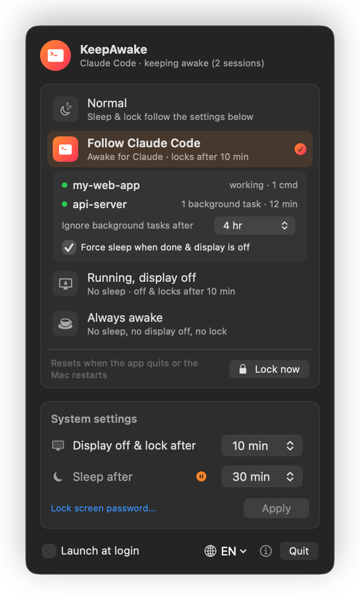
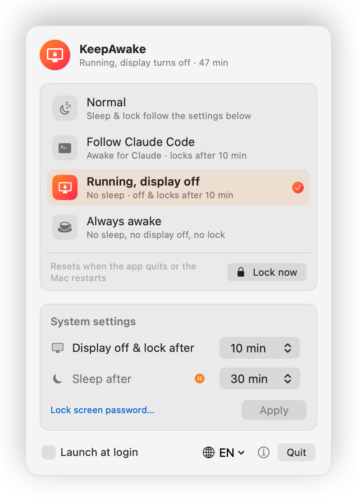
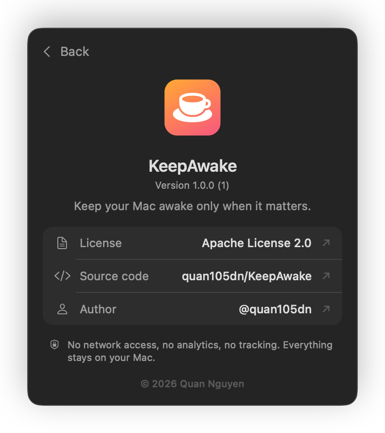

<p align="center">
  
</p>

<h1 align="center">KeepAwake</h1>

<p align="center">
  A tiny, native macOS menu bar app that keeps your Mac awake only when it matters,<br>
  with built-in support for <b>Claude Code</b> sessions.
</p>

<p align="center">
  <a href="https://github.com/quan105dn/KeepAwake/releases/latest"></a>
  
  
  <a href="LICENSE"></a>
  
</p>

<p align="center">
  English · <a href="README.vi.md">Tiếng Việt</a>
</p>

---

<p align="center">
  
  
  
</p>

## Why KeepAwake?

`caffeinate` keeps your Mac awake, but you have to remember to start it, stop it, and decide whether the
display should stay on too. KeepAwake puts that in your menu bar. It can also **follow Claude Code**:
the Mac stays awake while an agent is working, the screen still turns off and locks, and when the work is
done the Mac sleeps normally again.

## Features

### Four modes, one click

| Mode | Mac sleeps | Display turns off & locks | Typical use |
|---|---|---|---|
| **Normal** | per system settings | per system settings | everyday use |
| **Follow Claude Code** | **no**, while Claude Code is busy | per system settings | leave an agent running and walk away |
| **Running, display off** | **no** | per system settings | downloads, builds, SSH, rendering |
| **Always awake** | **no** | **no** | presentations, monitoring dashboards |

Modes are **temporary by design**. They hold IOKit power assertions (the same mechanism as `caffeinate`),
so quitting the app or restarting the Mac always brings you back to normal. They never change a system setting.

### Follow Claude Code

- Works wherever you run Claude Code: **Terminal, iTerm2, the VS Code / Cursor integrated terminal, the Claude Code
  extension for VS Code**, Warp, Ghostty and JetBrains terminals. Native, npm and extension installs are all supported.
  Each session in the menu is labelled with where it's running.
- Every 10 seconds the app finds every running Claude Code process and reads its session state from Claude Code's
  local transcript. The transcript is read only on your Mac and never leaves it.
- A session counts as **busy** while Claude is processing a turn, or while a shell command it started is still
  running, **including `run_in_background` tasks** that keep going after the turn ends.
- **No hooks, no config changes.** Nothing in `~/.claude/settings.json` is touched.
- **Safety limit:** background tasks running longer than a set time (default 4 h) are ignored, so a forgotten
  dev server can't keep your Mac awake forever.
- **Force sleep when done (optional, on by default):** once Claude has been idle for 2 minutes and you are away
  (the display is off), KeepAwake puts the Mac to sleep. This works even if a simulator or emulator holds an
  audio stream that would otherwise block sleep. It **never** forces sleep when:
  - system sleep is set to *Never*,
  - you started `caffeinate` yourself, or Time Machine is backing up,
  - another app is keeping the display on (for example, you're watching a video).

### Also included

- **Lock now**: locks and turns off the screen immediately. In the keep-awake modes the Mac keeps running.
- **System settings** in one place: *Display off & lock after* and *Sleep after* (`pmset`), with a shortcut to
  the Lock Screen password settings.
- **Launch at login** (`SMAppService`).
- **English and Vietnamese UI**, switchable in the app. Your choice is remembered.
- **Native and lightweight:** SwiftUI, no third-party dependencies, about 1 MB.

## Installation

### Download

1. Download `KeepAwake-vX.Y.Z-macos-arm64.zip` from the [latest release](https://github.com/quan105dn/KeepAwake/releases/latest).
2. Unzip it and move **KeepAwake.app** to `/Applications`.
3. KeepAwake is open-source and **not notarized by Apple**, so macOS blocks it the first time. Either
   right-click the app → **Open** → **Open**, or run:
   ```bash
   xattr -dr com.apple.quarantine /Applications/KeepAwake.app
   ```
4. (Optional) Verify the download against the `.sha256` file from the release:
   ```bash
   shasum -a 256 -c KeepAwake-vX.Y.Z-macos-arm64.zip.sha256
   ```

### Build from source

Only the Xcode **Command Line Tools** are needed (`xcode-select --install`).

```bash
git clone https://github.com/quan105dn/KeepAwake.git
cd KeepAwake
./build.sh install     # build, copy to /Applications and launch
```

`./build.sh` builds `build/KeepAwake.app`. `./build.sh release` also packages a zip and its SHA-256 checksum.

### Requirements

- macOS 13 Ventura or later
- Apple Silicon Mac (M1 or later)

## Privacy & Security

KeepAwake was built to be something you can trust on your machine.

- **No network access.** The app contains no networking code: no analytics, telemetry, crash reporting,
  update checks or tracking of any kind. Nothing about you or your Mac ever leaves your computer.
  The only links in the app (on the About screen) open your browser when you click them.
- **No data collection.** The list of running processes, power assertions and the *last few entries* of Claude Code's
  local transcripts (only to tell whether a turn is still in progress) are read locally, used for the decision at hand,
  and discarded. Nothing is stored or sent anywhere.
- **Changes your system only when you ask.** System settings change only when you click **Apply**. macOS then
  asks for your administrator password in its own dialog; KeepAwake never sees or stores your password.
- **No background daemons, no privileged helpers, no `sudo` rules.** The app runs as you, with your normal
  permissions.
- **No special permissions** such as Accessibility, Full Disk Access or Screen Recording.
- **Files it writes**, all local:
  - preferences in `~/Library/Preferences/com.quannguyenhoang.KeepAwake.plist`
  - a small diagnostic log, `~/Library/Logs/KeepAwake.log` (deleted automatically once it passes 1 MB)
- **External commands it runs:** only Apple's own `/usr/bin/pmset` and, after you click **Apply**,
  `/usr/bin/osascript`.
- **Open source:** every line is in [`Sources/`](Sources). Check the networking claim yourself:
  ```bash
  grep -rniE "URLSession|URLRequest|socket|http" Sources/
  ```
  The only matches are the three GitHub links on the About screen (`AboutView.swift`), which are opened in your
  browser when clicked.

> **Note:** *Lock now* calls `SACLockScreenImmediate`, a private macOS function, the same way many popular
> menu bar utilities do. If a future macOS removes it, the button falls back to just turning off the display.

## Limitations

- Closing a MacBook's lid always puts it to sleep, unless you're using clamshell mode (power adapter, external
  display, keyboard and mouse). KeepAwake deliberately does not override this.
- In *Follow Claude Code* mode, commands detached with `nohup … &` are no longer part of the Claude Code
  process tree, so they can't be tracked.
- Claude Code detection is based on how Claude Code currently runs, not on an official API, so a future
  Claude Code release could require an update.
- Release builds are for Apple Silicon only. Intel Macs can try building from source after changing the target
  in `build.sh`; this is untested.

## Troubleshooting

If *Follow Claude Code* doesn't pick up a session, run this while Claude is working. It only reads; nothing is changed:

```bash
/Applications/KeepAwake.app/Contents/MacOS/KeepAwake --diagnose
```

It lists every Claude Code process the app found, where it runs, its transcript state, and why it counts as busy or
idle. Please attach the output to a [GitHub issue](https://github.com/quan105dn/KeepAwake/issues).
The diagnostic log lives at `~/Library/Logs/KeepAwake.log`.

## How it works

| Feature | Mechanism |
|---|---|
| Keep awake | `IOPMAssertionCreateWithName` (`PreventUserIdleSystemSleep` / `PreventUserIdleDisplaySleep`) |
| Always awake | plus `IOPMAssertionDeclareUserActivity` every 30 s, so the screensaver and lock never trigger |
| Claude Code detection | `sysctl(KERN_PROC_ALL)` + `KERN_PROCARGS2` find `claude` processes; `~/.claude/sessions/<pid>.json` maps each one to its session |
| Turn in progress | last entry of `~/.claude/projects/<cwd>/<session>.jsonl` (and background `subagents/`): prompt, tool use or tool result means working; `end_turn` or `turn_duration` means done. Falls back to Claude's `caffeinate` child |
| Running commands | child shells started from `shell-snapshots` (including `run_in_background`) |
| Sleep blockers | `IOPMCopyAssertionsByProcess` |
| Force sleep | `pmset sleepnow` |
| Settings | `pmset -a displaysleep N sleep N` via an administrator prompt |
| Launch at login | `SMAppService.mainApp` |

## Versioning & releases

KeepAwake uses [Semantic Versioning](https://semver.org). The version lives in [`VERSION`](VERSION), and every
release is a git tag `vX.Y.Z` with a GitHub Release containing the zipped app and its SHA-256 checksum.
See [CHANGELOG.md](CHANGELOG.md).

```bash
echo "1.1.0" > VERSION && git commit -am "Release 1.1.0"
git tag v1.1.0 && git push --follow-tags
./build.sh release
gh release create v1.1.0 build/KeepAwake-v1.1.0-macos-arm64.zip* --notes-file <notes>
```

## Contributing

Issues and pull requests are welcome. Please keep the app dependency-free, and leave networking out unless
there's a very good reason, discussed in an issue first.

## License

Copyright © 2026 Quan Nguyen ([@quan105dn](https://github.com/quan105dn)).
Licensed under the [Apache License, Version 2.0](LICENSE).

*Claude and Claude Code are trademarks of Anthropic. KeepAwake is an independent project and is not affiliated
with or endorsed by Anthropic.*
