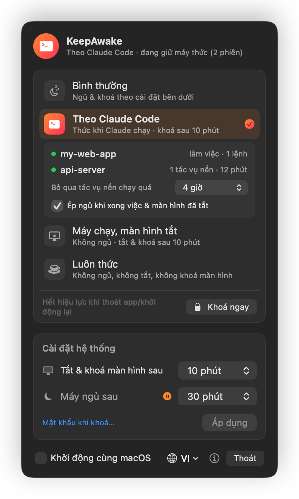
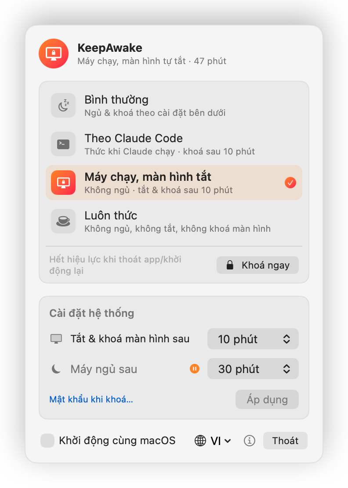
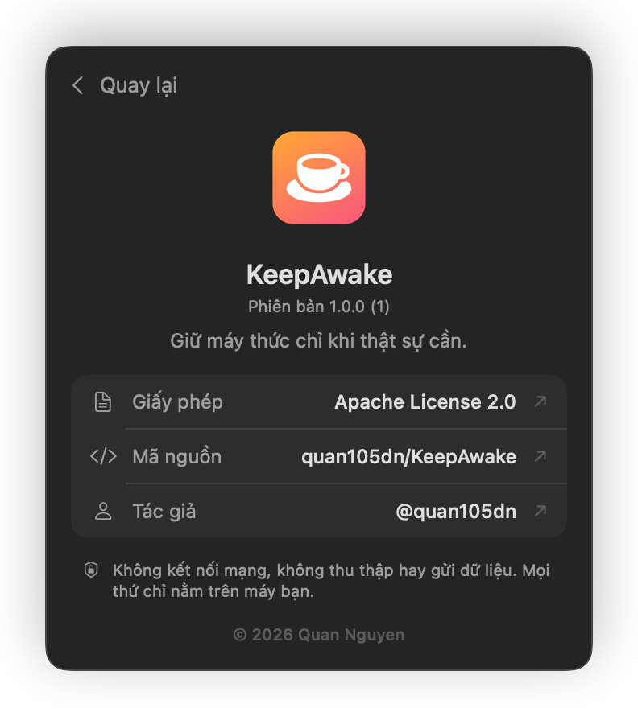

<p align="center">
  
</p>

<h1 align="center">KeepAwake</h1>

<p align="center">
  Ứng dụng nhỏ, native trên thanh menu macOS: giữ Mac thức chỉ khi thật sự cần,<br>
  có chế độ riêng để theo dõi các phiên <b>Claude Code</b>.
</p>

<p align="center">
  <a href="README.md">English</a> · Tiếng Việt
</p>

---

<p align="center">
  
  
  
</p>

## Tính năng

### Bốn chế độ, một cú bấm

| Chế độ | Máy ngủ | Màn hình tắt & khoá | Dùng khi |
|---|---|---|---|
| **Bình thường** | theo cài đặt | theo cài đặt | dùng hằng ngày |
| **Theo Claude Code** | **không**, khi Claude Code còn việc | theo cài đặt | để agent chạy rồi rời máy |
| **Máy chạy, màn hình tắt** | **không** | theo cài đặt | tải file, build, SSH, render |
| **Luôn thức** | **không** | **không** | trình chiếu, màn hình giám sát |

Các chế độ **chỉ có hiệu lực tạm thời**. Chúng dùng IOKit power assertion (cùng cơ chế với `caffeinate`), nên thoát
app hoặc khởi động lại máy là mọi thứ trở về bình thường, và không cài đặt hệ thống nào bị thay đổi.

### Theo Claude Code

- Cứ 10 giây app quét cây tiến trình của mọi phiên `claude`, cả bản cài native lẫn bản cài qua `npm`.
- Một phiên được coi là **bận** khi Claude đang xử lý một lượt, hoặc khi còn lệnh shell do Claude chạy, **kể cả
  tác vụ `run_in_background`** vẫn chạy sau khi lượt đã xong.
- **Không dùng hooks, không sửa file cấu hình** (`~/.claude/settings.json` giữ nguyên).
- **Giới hạn an toàn:** tác vụ nền chạy quá thời gian đặt sẵn (mặc định 4 giờ) sẽ bị bỏ qua.
- **Ép ngủ khi xong việc** (tuỳ chọn, mặc định bật): khi Claude đã rảnh 2 phút và bạn đã rời máy (màn hình đã tắt),
  app cho máy ngủ, kể cả khi simulator/emulator đang giữ âm thanh và chặn ngủ. App **không** ép ngủ khi:
  - "Máy ngủ sau" đặt là *Không bao giờ*;
  - bạn tự chạy `caffeinate`, hoặc Time Machine đang sao lưu;
  - có app đang giữ màn hình sáng (ví dụ đang xem video).

### Ngoài ra

- **Khoá ngay:** khoá và tắt màn hình tức thì; máy vẫn chạy nếu đang ở chế độ giữ thức.
- **Cài đặt hệ thống** gọn một chỗ: *Tắt & khoá màn hình sau*, *Máy ngủ sau*.
- **Khởi động cùng macOS.**
- **Giao diện tiếng Anh / tiếng Việt**, đổi ngay trong app và được ghi nhớ.
- **Nhẹ, native:** SwiftUI, không thư viện bên thứ ba, khoảng 1 MB.

## Cài đặt

1. Tải `KeepAwake-vX.Y.Z-macos-arm64.zip` ở [bản phát hành mới nhất](https://github.com/quan105dn/KeepAwake/releases/latest).
2. Giải nén và kéo **KeepAwake.app** vào `/Applications`.
3. App mã nguồn mở và **chưa được Apple notarize**, nên lần đầu macOS sẽ chặn. Chuột phải vào app → **Open** →
   **Open**, hoặc chạy:
   ```bash
   xattr -dr com.apple.quarantine /Applications/KeepAwake.app
   ```

**Build từ mã nguồn** (chỉ cần Command Line Tools, `xcode-select --install`):

```bash
git clone https://github.com/quan105dn/KeepAwake.git
cd KeepAwake
./build.sh install
```

**Yêu cầu:** macOS 13 trở lên, Mac chip Apple (M1 trở lên).

## Quyền riêng tư & bảo mật

- **Không kết nối mạng.** App không có bất kỳ code mạng nào: không analytics, không telemetry, không báo lỗi tự
  động, không kiểm tra cập nhật, không theo dõi. Không có thông tin nào về bạn hay máy của bạn được gửi ra ngoài.
  Các link trong màn hình giới thiệu chỉ mở trình duyệt khi bạn bấm vào.
- **Không thu thập dữ liệu.** Danh sách tiến trình và power assertion chỉ được đọc tại máy, dùng để quyết định ngay
  lúc đó rồi bỏ đi.
- **Chỉ thay đổi hệ thống khi bạn yêu cầu.** Cài đặt hệ thống chỉ đổi khi bạn bấm **Áp dụng**. Lúc đó hộp thoại
  mật khẩu là của macOS; app không bao giờ thấy hay lưu mật khẩu của bạn.
- **Không daemon chạy nền, không helper quyền root, không quy tắc `sudo`.**
- **Không cần quyền đặc biệt** như Accessibility, Full Disk Access, Screen Recording.
- **File app ghi ra** (đều ở máy bạn): file cài đặt trong `~/Library/Preferences/` và nhật ký chẩn đoán
  `~/Library/Logs/KeepAwake.log` (tự xoá khi quá 1 MB).
- **Mã nguồn mở:** bạn tự kiểm tra được:
  `grep -rniE "URLSession|URLRequest|socket|http" Sources/` chỉ ra 3 link GitHub trong màn hình giới thiệu.

> *Khoá ngay* dùng hàm riêng `SACLockScreenImmediate` của macOS. Nếu bản macOS sau bỏ hàm này, nút sẽ chỉ tắt
> màn hình.

## Giới hạn

- Gập nắp MacBook thì máy luôn ngủ (trừ khi dùng clamshell: cắm sạc, có màn hình ngoài, bàn phím và chuột rời).
- Lệnh tách ra bằng `nohup … &` không còn thuộc Claude Code nên app không theo dõi được.
- Cách nhận diện Claude Code dựa trên cách nó đang chạy hiện nay, không phải API chính thức.
- Bản phát hành chỉ dành cho Mac chip Apple.

## Giấy phép

Copyright © 2026 Quan Nguyen ([@quan105dn](https://github.com/quan105dn)), phát hành theo
[Apache License 2.0](LICENSE).

*Claude và Claude Code là thương hiệu của Anthropic. KeepAwake là dự án độc lập, không liên kết với Anthropic.*
